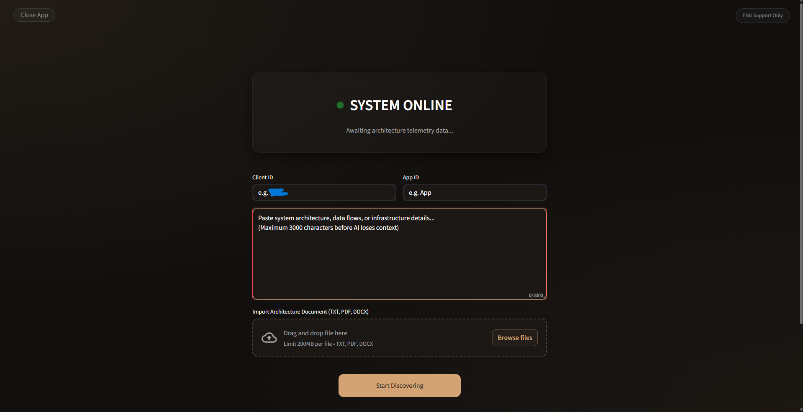
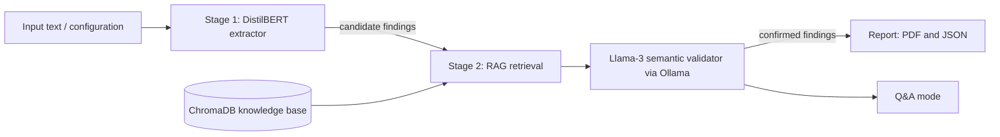
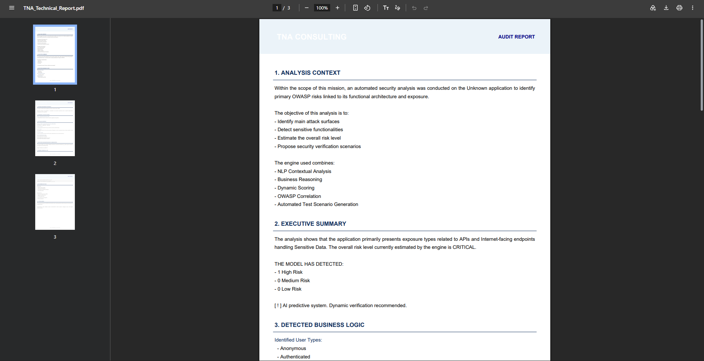
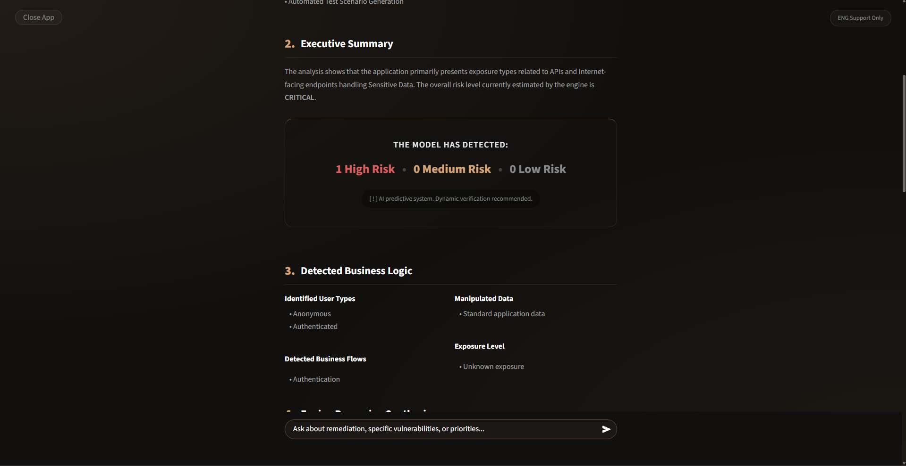

<h1 align="center">Hybrid Security Audit System</h1>

<p align="center">
  Automated vulnerability classification that pairs a fine-tuned transformer with a local LLM and retrieval-augmented validation.
</p>

<p align="center">
  
  
  
  
</p>

<p align="center">
  
</p>

## Overview

This Security Audit System is a project that automates the first pass of an application security audit. You describe an application or paste vulnerability-related text, and the system classifies it against six OWASP-aligned categories, verifies each finding against a knowledge base, and produces a structured report.

It follows a shift-left approach: it works on descriptions and design-level information before or alongside code testing, so it complements dynamic scanners such as Burp Suite and does not replace them.

**Covered categories:** SQL Injection, XSS, IDOR, Authentication Failures, CSRF, XXE.

## Architecture

The pipeline has two stages. A fast fine-tuned classifier proposes findings, then a local LLM checks them against retrieved evidence and drops the ones that do not hold up.



| Stage | Role | Technology |
| :--- | :--- | :--- |
| 1. Extractor | Multi-label classification of vulnerability categories, with guardrails applied in both directions | Fine-tuned DistilBERT (PyTorch, Hugging Face Transformers) |
| 2. Reasoner | Cross-checks each candidate against a semantic ontology and suppresses false positives | Llama-3 through Ollama, ChromaDB, Sentence-Transformers `all-MiniLM-L6-v2` |

## Key components

### DistilBERT extractor
A DistilBERT model fine-tuned on vulnerability descriptions to flag the six target categories. It runs first because it is fast and cheap, and it narrows the input before the slower LLM step. Bi-directional guardrails limit both missed findings and over-triggering.

- Training data: about 2,950 cleaned CVE entries from the NVD REST API, plus 503 synthetic entries, split 70/15/15 (stratified).
- Reported result: about 0.93 macro F1 on single-label evaluation.
- Baselines compared: zero-shot BART, TF-IDF with Random Forest, TF-IDF with Logistic Regression, RNN and LSTM.

### RAG knowledge base
A ChromaDB collection built from the documents in `rag_sources/` (OWASP Cheat Sheets, OWASP Top 10 and MITRE CWE entries, 16 documents in total), chunked by field type so retrieval returns the relevant definition, attack pattern or remediation. Embeddings come from `all-MiniLM-L6-v2`, and queries use metadata filtering to stay inside the right vulnerability category.

### Llama-3 semantic validator
A local Llama-3 model, served through Ollama, receives each candidate finding together with the retrieved evidence and decides whether it is supported. Findings that the evidence does not back are suppressed, which reduces false positives. Running locally means audit data never leaves the machine.

## Features

- Automated scan pipeline from input to validated findings
- PDF and JSON report generation
- Streamlit interface with dark mode
- Q&A mode for follow-up questions on a specific finding, its attack chain and remediation steps

## Visual walkthrough

**1. Input and configuration**

<p align="center">
  
</p>

**2. Audit report and attack chains**

<p align="center">
  
</p>

**3. Risk breakdown and metrics**

<p align="center">
  
</p>

## Tech stack

| Area | Tools |
| :--- | :--- |
| Language | Python |
| Deep learning | PyTorch, Hugging Face Transformers |
| NLP | spaCy, Sentence-Transformers |
| Retrieval | ChromaDB |
| Local LLM | Ollama (Llama-3) |
| API | FastAPI, Uvicorn |
| Interface | Streamlit |
| Reports | PDF and JSON export |

## Project structure

```
.
├── api_server.py        FastAPI backend exposing the audit pipeline
├── pipeline.py          Two-stage pipeline: extraction, retrieval, validation
├── dashboard.py         Streamlit interface
├── start_engine.bat     Windows script that starts the backend and the UI
├── install.bat          Windows environment setup script
├── requirements.txt     Python dependencies
├── model_final/         Tokenizer and config of the fine-tuned model
├── rag_sources/         Source documents for the knowledge base
│   ├── cheatsheets/     OWASP Cheat Sheet Series
│   ├── cwe/             CWE entries
│   └── top10/           OWASP Top 10
└── screenshots/         Images used in this README
```

## Getting started

### Prerequisites

- Python 3.10 or newer
- [Ollama](https://ollama.com) installed and running
- Git
- A CUDA-capable GPU is optional

### Installation

```bash
git clone https://github.com/MessyScribbles/Deep-Learning-Security-Audit.git
cd Deep-Learning-Security-Audit

python -m venv venv
venv\Scripts\activate          # Windows
# source venv/bin/activate     # macOS / Linux

pip install -r requirements.txt
python -m spacy download en_core_web_sm
```

### Download the model

The trained weights are too large for the repository. Download `model.safetensors` from the [Releases page](https://github.com/MessyScribbles/Deep-Learning-Security-Audit/releases) and place it in `model_final/`, next to `config.json` and `tokenizer.json`.

### Pull the local LLM

```bash
ollama pull llama3
```

### Run with the startup script (Windows)

```bash
start_engine.bat
```

### Run manually

In one terminal, start the API:

```bash
uvicorn api_server:app --host 127.0.0.1 --port 5000
```

In a second terminal, start the interface:

```bash
streamlit run dashboard.py
```

Then open the address Streamlit prints (usually `http://localhost:8501`).

## Troubleshooting

### The API port does not work

The API listens on port **5000** and the dashboard calls it at `http://127.0.0.1:5000`. If the port is busy or blocked, the dashboard shows a connection error. To change it:

1. **Check what is using the port** (Windows):
   ```bash
   netstat -ano | findstr :5000
   ```
   If a process appears, close it or choose another port.

2. **Check whether Windows reserved the port range:**
   ```bash
   netsh interface ipv4 show excludedportrange protocol=tcp
   ```
   If 5000 falls inside a listed range, use a port outside every range (for example `5050` or `9000`). An `EACCES` or "permission denied" error usually means this.

3. **Change the port in every place so they match:**
   - API command: `uvicorn api_server:app --host 127.0.0.1 --port 5050`
   - Dashboard: in `dashboard.py`, update the API URL to `http://127.0.0.1:5050`
   - If you use `start_engine.bat`, update the port in that file too

4. Restart both processes.

### The dashboard port does not work

Streamlit uses port 8501 by default. Run it on another port:

```bash
streamlit run dashboard.py --server.port 8502
```

### The dashboard shows "connection refused" or a timeout

- Start the API first and wait until its terminal shows that startup has finished.
- Check that the API URL in `dashboard.py` matches the port the API is using.
- A firewall prompt may have blocked Python. Allow it and retry.

### Ollama errors or no response from the validator

- Check that Ollama is running: `ollama list`.
- Make sure the model is installed: `ollama pull llama3` (use the exact model name set in `pipeline.py`).
- Ollama listens on port 11434. If another program uses it, stop that program.

### Model not found

Make sure `model.safetensors` is in `model_final/`. See "Download the model" above.

### Dependency errors

Use a clean virtual environment and reinstall:

```bash
python -m venv venv
venv\Scripts\activate
pip install -r requirements.txt
```

## Limitations

- Coverage is limited to six vulnerability categories.
- Results depend on the quality and detail of the input description.
- The knowledge base is small (16 documents) and does not replace a full manual review.
- The tool supports an audit. A security professional should confirm the findings.

## Acknowledgements

Knowledge base content comes from the OWASP Cheat Sheet Series and OWASP Top 10 (licensed under CC BY-SA) and from MITRE CWE.

## Author

**Mohamed El Hamzaoui**

- GitHub: [@MessyScribbles](https://github.com/MessyScribbles)
